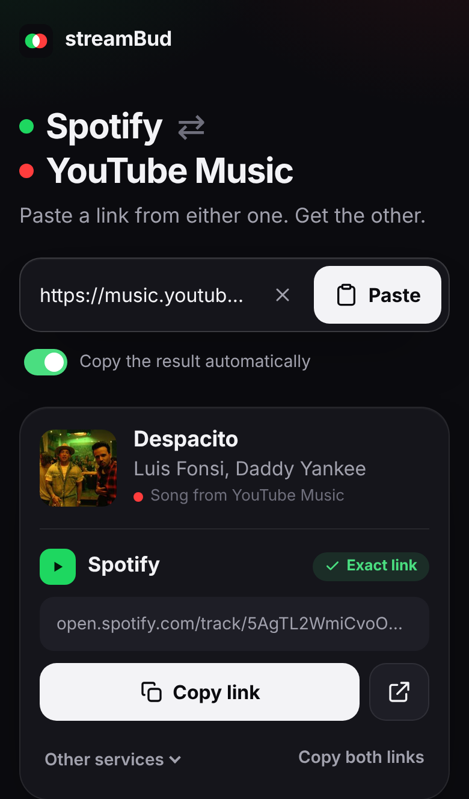

# streamBud

**Spotify ⇄ YouTube Music.** Paste a link from either one, get the other. Free, no sign-up, no AI.

Your friend sends a Spotify link, you have YouTube Music. You send a YouTube Music link, they have Spotify. Paste it into streamBud and get a link for the other app, ready to copy or share.

<p align="center"></p>

## What it does


- **Paste anything.** A bare link, a `spotify:` URI, a short `spotify.link`, a YouTube/YouTube Music/youtu.be link, or a whole message with a link somewhere in it.
- **One big Copy button**, plus Open and Share (on phones). The result can be **copied automatically** as soon as it's ready.
- **Copy both links** gives you the song name with the Spotify and YouTube Music links, so whoever gets it can tap theirs.
- **Recent conversions** are kept on your device (only there) so you can find the song your friend sent last week.
- **Other services:** YouTube, Apple Music, Deezer, Tidal, SoundCloud, Amazon Music, and a song.link page that lists every app.
- **Share straight from the app:** install it on Android and it shows up in Spotify's and YouTube Music's Share menu. On iPhone, a small Shortcut does the same (instructions are in the app).
- Works for **songs and albums**. Spotify artist links give a search link. Playlists and podcasts aren't supported.

### Exact link vs. search link

Every result is labelled:

- **Exact link** — streamBud found the track itself and checked that the title and artist match.
- **Search link** — streamBud couldn't confirm the exact track, so the link opens the other app already searching for "song + artist". The song is almost always the top result.

| Direction | Out of the box | With a free YouTube API key |
| --- | --- | --- |
| YouTube Music / YouTube → **Spotify** | Exact link for most songs (23 of 24 popular songs in testing), search link otherwise | Same, with better song info |
| Spotify → **YouTube Music** | Search link | Exact link |

## How it works (and why no API key is needed)

The free song.link (Odesli) API that most converters used was shut down in 2026, and Spotify's own API now needs a paid Premium account. So streamBud matches songs itself, using free and open sources:

1. **Read the link you pasted.** For Spotify, the public embed player page (the same one used for Spotify players on blogs) gives the title, artists and cover art. Spotify's oEmbed is the fallback. For YouTube, YouTube's official oEmbed gives the video title and channel, which streamBud cleans up. For example, `Luis Fonsi - Despacito ft. Daddy Yankee (Official Video)` from *LuisFonsiVEVO* becomes **Despacito** by **Luis Fonsi, Daddy Yankee**.
2. **Find it on the other service.**
   - *Spotify:* [ListenBrainz](https://listenbrainz.org) (run by the non-profit MetaBrainz) maps songs to Spotify IDs. Each candidate is checked against Spotify before it's used, so you don't get a karaoke or live version by mistake.
   - *YouTube Music:* YouTube only allows searching through its Data API, which needs a free key (see below). Without one you get a search link.
3. Anything that can't be confirmed becomes a **search link** instead of a wrong guess.

There's no AI anywhere: just text clean-up and word matching. It lives in `lib/text.js` and has tests.

## Put it online (free)

streamBud is a static page plus one small serverless function. [Vercel](https://vercel.com)'s free Hobby plan runs it at no cost:

1. Sign in to Vercel with GitHub and click **Add New → Project**.
2. Import this repository. Keep the defaults (Framework: *Other*). `vercel.json` already sets everything.
3. Click **Deploy**. You get a URL like `streambud-yourname.vercel.app`. Open it on your phone and add it to your home screen.

Any other Node host works too (`npm start` serves both the page and the API). The page alone can't run on GitHub Pages, because the conversion needs the small server function.

### Optional: exact YouTube Music links (free YouTube API key, ~5 minutes)

1. Go to <https://console.cloud.google.com/>, create a project (any name).
2. **APIs & Services → Library** → search **YouTube Data API v3** → **Enable**.
3. **APIs & Services → Credentials → Create credentials → API key**. Restrict it to *YouTube Data API v3*.
4. In Vercel: **Project → Settings → Environment Variables** → add `YOUTUBE_API_KEY` = your key → redeploy.

It's free and needs no billing. The free quota covers about 100 Spotify → YouTube Music conversions a day, plus a day of caching per song.

### Optional: Spotify Web API

If someone has **Spotify Premium** (Spotify requires that for developer apps since February 2026), they can create an app at <https://developer.spotify.com/dashboard> and add `SPOTIFY_CLIENT_ID` and `SPOTIFY_CLIENT_SECRET`. streamBud then searches Spotify directly before trying ListenBrainz. You don't need it: ListenBrainz already finds most songs.

## Share straight from Spotify / YouTube Music

- **Android:** open your streamBud site in Chrome → ⋮ → **Add to Home screen / Install app**. Then in Spotify or YouTube Music: **Share → streamBud**.
- **iPhone:** web apps can't join the iOS share sheet, so use a Shortcut: *Receive URLs/Text from Share Sheet* → *URL Encode* → *Open URLs* `https://<your-site>/?text=<URL Encoded Text>`. The exact steps, with your site's address filled in, are under "Skip the copy-paste" in the app.
- **Anywhere:** `https://<your-site>/?url=<link>` opens streamBud and converts right away.

## Run it locally

Needs Node 20+. There are no dependencies to install.

```sh
npm start          # http://localhost:3000
npm test           # unit + integration tests (no network needed)
YOUTUBE_API_KEY=... npm start   # with exact YouTube Music links
```

## Privacy

No accounts, no cookies, no analytics. Recent conversions are stored only in your browser. The server sees the link you convert and passes the song's title and artist to Spotify, YouTube and ListenBrainz to find a match. Answers are cached for a day.

## Project layout

```
public/            the app (index.html, app.js, styles.css, icons, manifest)
api/convert.js     Vercel function: GET /api/convert?url=<link>
lib/parse.js       finds and recognises Spotify / YouTube links
lib/text.js        title clean-up and song matching
lib/sources/       Spotify, YouTube and ListenBrainz lookups
lib/convert.js     puts it together
server.js          local / self-hosted server
test/              node --test suites
```
